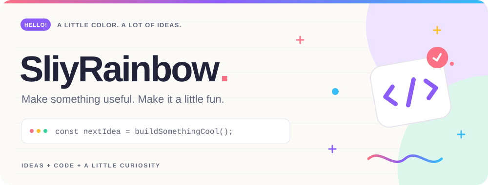
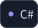
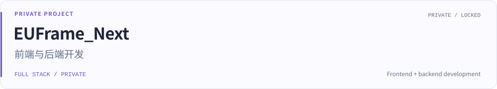
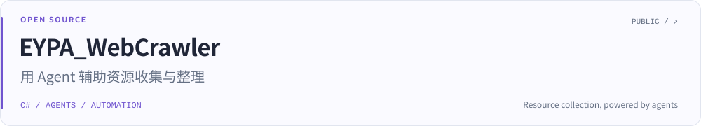
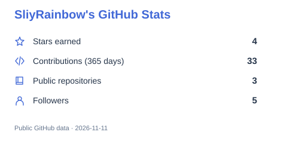
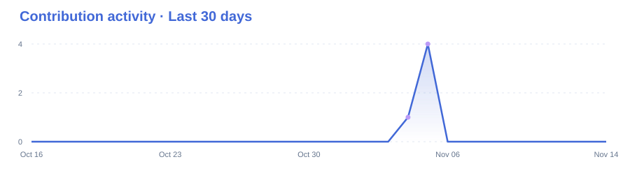
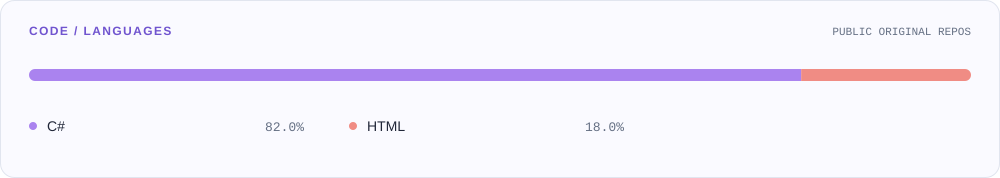

<picture>
  <source media="(max-width: 600px) and (prefers-color-scheme: dark)" srcset="./assets/hero-mobile-dark.svg">
  <source media="(max-width: 600px)" srcset="./assets/hero-mobile.svg">
  <source media="(prefers-color-scheme: dark)" srcset="./assets/hero-dark.svg">
  
</picture>

  
  
  
  

主要在做 **EUFrame_Next** 的前端与后端，以及 **EYPA_WebCrawler** 的资源收集与整理。喜欢把完整的开发流程打通，让工具更顺手。

### 项目 / Selected work

<picture>
  <source media="(max-width: 600px) and (prefers-color-scheme: dark)" srcset="./assets/euframe-mobile-dark.svg">
  <source media="(max-width: 600px)" srcset="./assets/euframe-mobile.svg">
  <source media="(prefers-color-scheme: dark)" srcset="./assets/euframe-dark.svg">
  
</picture>

<a href="https://github.com/SliyRainbow/EYPA_WebCrawler">
<picture>
  <source media="(max-width: 600px) and (prefers-color-scheme: dark)" srcset="./assets/webcrawler-mobile-dark.svg">
  <source media="(max-width: 600px)" srcset="./assets/webcrawler-mobile.svg">
  <source media="(prefers-color-scheme: dark)" srcset="./assets/webcrawler-dark.svg">
  
</picture>
</a>

### 数据 / GitHub by the numbers

<a href="https://github.com/SliyRainbow?tab=repositories">
<picture>
  <source media="(max-width: 600px) and (prefers-color-scheme: dark)" srcset="./assets/stats-mobile-dark.svg">
  <source media="(max-width: 600px)" srcset="./assets/stats-mobile.svg">
  <source media="(prefers-color-scheme: dark)" srcset="./assets/stats-dark.svg">
  
</picture>
</a>

<a href="https://github.com/SliyRainbow?tab=overview">
<picture>
  <source media="(max-width: 600px) and (prefers-color-scheme: dark)" srcset="./assets/activity-mobile-dark.svg">
  <source media="(max-width: 600px)" srcset="./assets/activity-mobile.svg">
  <source media="(prefers-color-scheme: dark)" srcset="./assets/activity-dark.svg">
  
</picture>
</a>

<picture>
  <source media="(max-width: 600px) and (prefers-color-scheme: dark)" srcset="./assets/languages-mobile-dark.svg">
  <source media="(max-width: 600px)" srcset="./assets/languages-mobile.svg">
  <source media="(prefers-color-scheme: dark)" srcset="./assets/languages-dark.svg">
  
</picture>

统计取自 GitHub 公开可见数据，每日更新；语言分布不包含私密项目、Fork 和个人主页仓库。

---

[项目反馈](https://github.com/SliyRainbow/EYPA_WebCrawler/issues) · [GitHub](https://github.com/SliyRainbow) · Friends: [@Steve3957](https://github.com/Steve3957)

Build the interface. Connect the backend. Keep improving.
