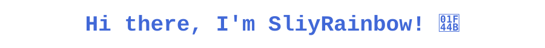
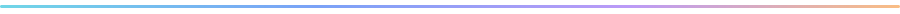
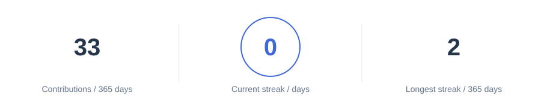
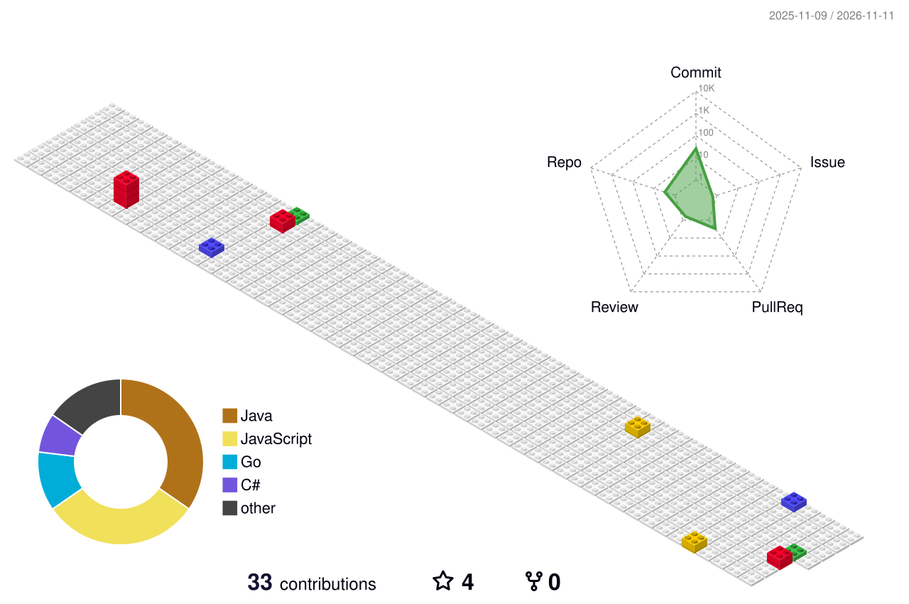

<picture>
  <source media="(prefers-color-scheme: dark)" srcset="./assets/welcome-dark.svg">
  
</picture>

Full-stack development · Agent automation · Keep building

<picture>
  <source media="(prefers-color-scheme: dark)" srcset="./assets/coding.gif">
  
</picture>

  

<a href="https://github.com/SliyRainbow?tab=followers">
<picture>
  <source media="(prefers-color-scheme: dark)" srcset="./assets/social-dark.svg">
  
</picture>
</a>

  

<picture>
  <source media="(prefers-color-scheme: dark)" srcset="./assets/snake-dark.svg">
  
</picture>

## 🙋 Hello

### 🧑‍💻 About me

- 🧑‍💻 主要负责 **EUFrame_Next** 的前端与后端开发。
- 🔒 EUFrame_Next 是私密项目，这里展示我的开发方向与分工。
- 🤖 同时开发 **[EYPA_WebCrawler](https://github.com/SliyRainbow/EYPA_WebCrawler)**，用 Agent 辅助资源收集与整理。

### 🚀 My projects

- **EUFrame_Next** `Private` — 前端与后端开发。
- **[EYPA_WebCrawler](https://github.com/SliyRainbow/EYPA_WebCrawler)** — 资源收集、整理与 Agent 自动化。

### 🛠️ Tech & tools

<picture>
  <source media="(prefers-color-scheme: dark)" srcset="./assets/skills-dark.svg">
  
</picture>

## 📊 GitHub stats

<picture>
  <source media="(prefers-color-scheme: dark)" srcset="./assets/stats-dark.svg">
  
</picture>
<picture>
  <source media="(prefers-color-scheme: dark)" srcset="./assets/languages-dark.svg">
  
</picture>

 

<picture>
  <source media="(max-width: 600px) and (prefers-color-scheme: dark)" srcset="./assets/streak-mobile-dark.svg">
  <source media="(max-width: 600px)" srcset="./assets/streak-mobile.svg">
  <source media="(prefers-color-scheme: dark)" srcset="./assets/streak-dark.svg">
  
</picture>

<picture>
  <source media="(prefers-color-scheme: dark)" srcset="./assets/activity-dark.svg">
  
</picture>

数据每日更新，取自 GitHub 公开可见信息。语言占比仅统计原创公开仓库，不包含私密项目和个人主页素材。

## 🧊 My contribution world

<picture>
  <source media="(prefers-color-scheme: dark)" srcset="./assets/contributions-3d-dark.svg">
  
</picture>

  <a href="https://github.com/SliyRainbow/EYPA_WebCrawler/issues">项目交流</a> · <a href="https://github.com/SliyRainbow">GitHub</a> · Friends: <a href="https://github.com/Steve3957">@Steve3957</a>

<picture>
  <source media="(prefers-color-scheme: dark)" srcset="./assets/footer-dark.svg">
  
</picture>

Layout inspired by <a href="https://github.com/sun0225SUN">sun0225SUN</a> · <a href="./THIRD_PARTY.md">Credits</a>
