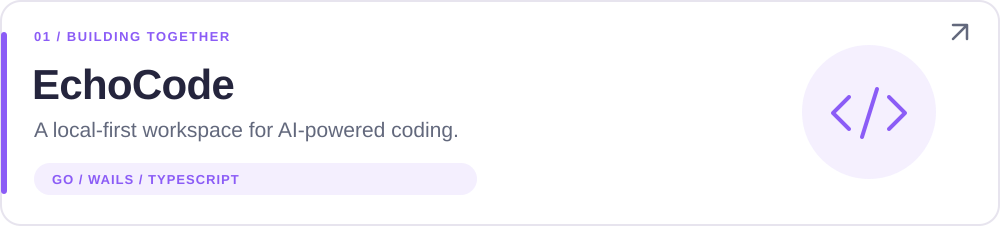

<picture>
  <source media="(prefers-color-scheme: dark)" srcset="./assets/hero-dark.svg">
  
</picture>

  
  
  

## 嗨，我是 SliyRainbow 👋

喜欢把脑海里的点子，变成真正能用的工具。

参与 **EchoCode** 的开发与探索，关注 **AI Agent、桌面应用和工作流自动化**。这里记录正在做的项目，也欢迎一起交流、一起打磨。

## 🧩 正在做的事

<a href="https://github.com/Steve3957/EchoCode">
<picture>
  <source media="(prefers-color-scheme: dark)" srcset="./assets/echocode-dark.svg">
  
</picture>
</a>

把 AI Agent、开发工具、Git 和终端放进同一个桌面工作台。仓库现由 [Steve3957](https://github.com/Steve3957) 管理和维护。

<a href="https://github.com/SliyRainbow/EYPA_WebCrawler">
<picture>
  <source media="(prefers-color-scheme: dark)" srcset="./assets/webcrawler-dark.svg">
  
</picture>
</a>

用 Agent 技术辅助资源收集与整理，探索更顺手的信息工作流。

## 🛠️ 项目里的技术

  
  
  
  
  

## 🌱 最近关注

- 让 AI Agent 更贴近日常开发。
- 把桌面工具和自动化工作流做得更顺手。
- 把有意思的想法，一点点做成开源项目。

## 💬 一起聊聊

欢迎通过 [EchoCode Issues](https://github.com/Steve3957/EchoCode/issues) 交流使用体验、问题和想法，也欢迎用 Pull Request 带来改进。

一起打磨 EchoCode：[@Steve3957](https://github.com/Steve3957) · [查看 EchoCode](https://github.com/Steve3957/EchoCode) · [下载发布版本](https://github.com/Steve3957/EchoCode/releases)

